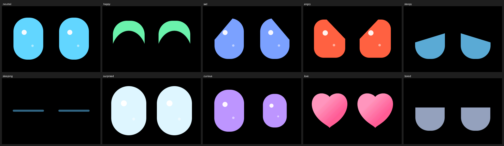

# Robo Friend - animated eyes firmware for Waveshare ESP32-S3-Touch-AMOLED-2.06

English | [Русский](#русский)



Two big glowing eyes for your Waveshare AMOLED board. They blink, look around, follow your finger and change mood. Everything runs on the board itself: no Wi-Fi, no account, no cloud.

> **Status: BETA (v0.1).** The code builds and its logic is tested on a PC, but it has not been verified on every board yet. Testers wanted - please open an issue and tell us what you see.

## Compatible board

**Only: Waveshare ESP32-S3-Touch-AMOLED-2.06** (2.06" AMOLED, 410x502, CO5300 display, FT3168 touch).

**NOT compatible:** the other Waveshare AMOLED boards (1.43", 1.64", 1.75", 1.8", 1.91", 2.16", 2.41"), plain ESP32 / ESP32-S2 / ESP32-C3 boards, or any board without this screen. Do not flash it on them.

## What it does

| You do | It does |
| --- | --- |
| Tap | Gets startled, then smiles |
| Tap again and again | Gets annoyed |
| Hold a finger or stroke it | Heart eyes, then happy |
| Touch anywhere | Eyes follow your finger |
| Leave it alone | Curious -> bored -> sleepy -> falls asleep (screen dims) |
| Touch it while asleep | Wakes up surprised |
| Ignore it for a long time | Gets sad |

Moods: neutral, happy, sad, angry, sleepy, sleeping, surprised, curious, love, bored.

## Install (no programming needed)

You need: the board, a USB-C cable **that carries data** (not a charge-only cable), a computer with **Chrome or Edge**.

1. Download `robo_friend.ino.merged.bin` from the **Releases** page of this repository.
2. Plug the board into your computer.
3. Put the board into download mode: **hold BOOT, press and release RESET, then release BOOT.** The screen may stay blank - that is normal.
4. Open https://adafruit.github.io/Adafruit_WebSerial_ESPTool/ in Chrome or Edge.
5. Click **Connect** and choose the board's COM / serial port.
6. In the first row set the offset to **`0x0`**, click **Choose a file...** and select `robo_friend.ino.merged.bin`.
7. Click **Program** and wait until it finishes (about a minute). Do not unplug.
8. Press **RESET** (or re-plug the cable). The eyes should appear.

### Alternative: esptool (command line)

```
python -m pip install esptool
esptool.py --chip esp32s3 --port COM5 write_flash 0x0 robo_friend.ino.merged.bin
```
Replace `COM5` with your port (on Linux/macOS something like `/dev/ttyACM0`).

## Go back to the original firmware

Flashing this firmware does not damage the board. To restore Waveshare's factory demo, take the file `ESP32-S3-Touch-AMOLED-2.06_FactoryOnly_....bin` from the `firmware` folder of
https://github.com/waveshareteam/ESP32-S3-Touch-AMOLED-2.06 and flash it the same way at offset `0x0` (erase flash first for a clean start).

## Troubleshooting

- **The port does not appear:** use another cable (many cables are charge-only), try another USB port, repeat BOOT + RESET.
- **Black screen after flashing:** re-plug the cable, then flash again. If still black, open an issue.
- **Eyes appear but touch does nothing / is wrong:** open an issue and describe what happens.
- **Flashing is stuck:** re-enter download mode (BOOT + RESET) and press Connect again.

If you open an issue, please include: what you did, what you saw, and the board's exact name on the label.

## Roadmap

Shake / pick-up / steps, time-of-day sleep, battery mood, weather mood, sounds, mini-games, clock mode, over-the-air updates.

---

# Русский

Два больших светящихся глаза для платы Waveshare с AMOLED-экраном. Они моргают, оглядываются, следят за пальцем и меняют настроение. Всё работает на самой плате: без Wi-Fi, без аккаунтов, без облака.

> **Статус: БЕТА (v0.1).** Код собирается, логика проверена на компьютере, но на всех платах прошивка ещё не проверена. Нужны тестировщики: откройте Issue и напишите, что у вас получилось.

## Какая плата подходит

**Только: Waveshare ESP32-S3-Touch-AMOLED-2.06** (экран 2,06″, 410x502, контроллер CO5300, тач FT3168).

**Не подходит:** остальные платы Waveshare с AMOLED (1.43″, 1.64″, 1.75″, 1.8″, 1.91″, 2.16″, 2.41″), обычные ESP32 / ESP32-S2 / ESP32-C3 и любые платы без этого экрана. На них прошивать нельзя.

## Что умеет

| Вы делаете | Он делает |
| --- | --- |
| Нажимаете | Пугается, потом улыбается |
| Тыкаете много раз подряд | Злится |
| Держите палец или гладите | Глаза-сердечки, потом радость |
| Касаетесь экрана | Глаза следят за пальцем |
| Не трогаете | Любопытство, скука, сонливость, засыпает (экран тускнеет) |
| Касаетесь, пока спит | Просыпается удивлённым |
| Долго игнорируете | Грустит |

## Установка (программировать не нужно)

Нужно: плата, кабель USB-C **с передачей данных** (не только для зарядки), компьютер с браузером **Chrome или Edge**.

1. Скачайте файл `robo_friend.ino.merged.bin` на странице **Releases** этого репозитория.
2. Подключите плату к компьютеру.
3. Включите режим загрузки: **зажмите BOOT, нажмите и отпустите RESET, отпустите BOOT.** Экран может оставаться тёмным, это нормально.
4. Откройте в Chrome или Edge: https://adafruit.github.io/Adafruit_WebSerial_ESPTool/
5. Нажмите **Connect** и выберите COM-порт платы.
6. В первой строке укажите смещение **`0x0`**, нажмите **Choose a file...** и выберите `robo_friend.ino.merged.bin`.
7. Нажмите **Program** и дождитесь конца (около минуты). Ничего не отключайте.
8. Нажмите **RESET** на плате (или переподключите кабель). Должны появиться глаза.

## Вернуть заводскую прошивку

Эта прошивка плату не повреждает. Чтобы вернуть заводское демо Waveshare, возьмите файл `ESP32-S3-Touch-AMOLED-2.06_FactoryOnly_....bin` из папки `firmware` репозитория
https://github.com/waveshareteam/ESP32-S3-Touch-AMOLED-2.06 и прошейте его так же, со смещением `0x0` (для чистого старта сначала сотрите flash).

## Если не работает

- **Порт не появляется:** другой кабель (часто они только для зарядки), другой USB-порт, повторите BOOT + RESET.
- **Чёрный экран после прошивки:** переподключите кабель и прошейте ещё раз. Если не помогло, создайте Issue.
- **Глаза есть, но тач не работает или ведёт себя странно:** создайте Issue и опишите, что происходит.
- **Прошивка зависла:** снова войдите в режим загрузки (BOOT + RESET) и нажмите Connect.

В Issue напишите: что делали, что увидели, и точное название платы с наклейки.

---

# Для разработчиков / For developers

- GitHub Actions (`.github/workflows/build.yml`) собирает прошивку автоматически: вкладка **Actions**, раздел **Artifacts**.
- Arduino IDE: плата ESP32S3 Dev Module, Flash 16MB, Partition `16M Flash (3MB APP/9.9MB FATFS)`, PSRAM `OPI PSRAM`, USB CDC On Boot `Enabled`, ядро esp32 версии 3.3.11. Нужна библиотека `Arduino_GFX` из репозитория Waveshare (папка `examples/arduino/libraries/Arduino_GFX`).
- Код: `firmware/robo_friend/`. Тесты и превью: `test/`, `tools/`.
- Не используйте библиотеку Waveshare `Arduino_DriveBus` (GPL-3.0), здесь свой драйвер тача. Лицензии сторонних компонентов: `NOTICE.md`.
